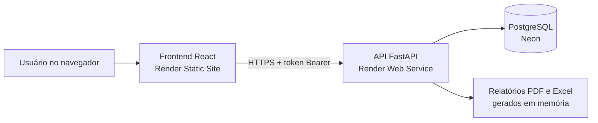

# Barakah Decor · Sistema de Gestão de Estoque, Vendas e Financeiro

Sistema web desenvolvido sob medida para uma loja de embalagens e decorações que controlava o estoque e as vendas de forma manual. Fui responsável pelo projeto de ponta a ponta: entendimento da necessidade, desenvolvimento do backend e do frontend, deploy em nuvem e manutenção.

> Projeto real, usado pela cliente em produção e divulgado aqui com autorização. Todos os dados exibidos nas imagens são fictícios.


---

## O problema

A loja precisava saber, sem depender de planilhas soltas:

- quanto tinha de cada produto e quais estavam acabando;
- quanto vendia por dia, por semana e por mês;
- o que entrava e saía no caixa;
- quais produtos vendiam mais;
- e precisava gerar relatórios para acompanhar o negócio.

## A solução

Um sistema web acessível pelo navegador, com login, que concentra estoque, vendas, compras e financeiro em um só lugar.

| Módulo | O que faz |
|---|---|
| **Dashboard** | Vendas do dia e do mês com variação em relação ao período anterior, gráfico de vendas, produtos acabando, mais vendidos e resumo financeiro |
| **Produtos** | Cadastro com foto, categoria, preço e estoque mínimo próprio |
| **Entradas, Saídas e Compras** | Movimentação de estoque com histórico completo e validação de estoque insuficiente |
| **Alertas** | Produtos sem estoque, críticos ou em atenção, com sugestão de reposição |
| **Financeiro** | Receitas, despesas, lucro e margem |
| **Relatórios** | Indicadores gerenciais e exportação em **PDF** e **Excel** com várias abas |
| **Usuários** | Perfis de Administrador e Operador, com redefinição de senha e bloqueio de acesso |
| **Configurações** | Dados da empresa e regras de alerta compartilhadas entre todos os computadores |

<p align="center">
  
  
</p>

---

## Stack

**Backend:** Python, FastAPI, SQLAlchemy, Pydantic, ReportLab (PDF) e OpenPyXL (Excel)
**Frontend:** React, Vite, Tailwind CSS, Recharts, Axios e Lucide Icons
**Banco de dados:** PostgreSQL no Neon (SQLite no desenvolvimento local)
**Infraestrutura:** Render, com deploy automático a cada push na branch `main`

## Arquitetura



O backend é organizado por responsabilidade:

```text
backend/
  main.py          criação da API e registro das rotas
  security.py      hash de senhas, sessões e permissões
  migrations.py    ajustes automáticos no banco ao iniciar
  models.py        tabelas
  schemas.py       validação dos dados recebidos
  routers/         rotas separadas por assunto (produtos, estoque, usuários...)
  services/        regras de negócio, relatórios, imagens e configurações
frontend/
  src/pages/       uma tela por módulo
  src/components/  layout e componentes compartilhados
  src/utils/       autenticação, formatação, navegação e API
```

---

## Decisões técnicas

**Uma única regra de alertas, calculada no backend.** Cada produto tem seu próprio estoque mínimo e fica crítico abaixo de um percentual configurável desse mínimo. Como a regra mora no servidor, Dashboard, Relatórios e Alertas sempre mostram o mesmo resultado.

**Imagens dos produtos salvas no banco.** O plano gratuito do Render apaga o disco a cada deploy. Guardar as imagens no PostgreSQL evitou perder as fotos sem precisar contratar um serviço de armazenamento à parte.

**Valores em `NUMERIC(12, 2)`.** Dinheiro em ponto flutuante gera erros de centavos. A migração das colunas antigas roda automaticamente quando a API sobe.

**Relatórios gerados em memória.** PDF e Excel são montados direto na resposta, sem gravar arquivos no servidor. Isso evita conflito entre downloads simultâneos e não deixa dados da loja salvos em disco.

**Dependências com versão fixa.** Uma atualização de biblioteca chegou a quebrar o deploy. Fixar as versões no `requirements.txt` e a versão do Python garantiu que o que funciona localmente funcione em produção.

## Segurança e LGPD

- Senhas guardadas com hash **PBKDF2-SHA256** e salt aleatório
- Token de sessão enviado apenas no cabeçalho `Authorization`, nunca na URL
- Sessões com validade e encerradas ao trocar a senha, pausar ou excluir um usuário
- Bloqueio de login por 15 minutos após tentativas erradas repetidas
- Controle de acesso por perfil, validado no backend
- Ações destrutivas, como zerar os dados, restritas a administradores e confirmadas com senha
- Nenhum dado pessoal fixo no código, e credenciais apenas em variáveis de ambiente

---

## Como rodar localmente

**Backend**

```bash
cd backend
python -m venv venv
venv\Scripts\activate
pip install -r requirements.txt
```

Defina o primeiro administrador e suba a API:

```powershell
$env:ADMIN_EMAIL="admin@exemplo.com"
$env:ADMIN_PASSWORD="umasenhaforte"
python -m uvicorn main:app --reload
```

A API fica em `http://127.0.0.1:8000` e a documentação interativa em `http://127.0.0.1:8000/docs`.

**Frontend**

```bash
cd frontend
npm install
npm run dev
```

Acesse `http://localhost:5173`.

## Variáveis de ambiente

| Variável | Onde | Para que serve |
|---|---|---|
| `DATABASE_URL` | Backend | Conexão com o PostgreSQL. Sem ela, usa SQLite local |
| `FRONTEND_URL` | Backend | Endereço do frontend liberado no CORS |
| `ADMIN_EMAIL`, `ADMIN_NAME`, `ADMIN_PASSWORD` | Backend | Criam o primeiro administrador, se o e-mail ainda não existir |
| `VITE_API_URL` | Frontend | Endereço da API |

---

## O que aprendi

- **Entender o negócio vem antes do código.** As telas mais usadas foram as que respondiam perguntas do dia a dia da loja, como "o que está acabando?" e "quanto vendi hoje?".
- **Produção ensina o que o ambiente local esconde.** Disco que some a cada deploy, bibliotecas que mudam de versão e dados que precisam de backup antes de qualquer migração.
- **Segurança é parte da entrega.** Revisar o projeto depois de pronto revelou dados pessoais expostos no frontend e telas que pareciam funcionar mas não salvavam nada no servidor. Corrigir isso foi tão importante quanto as funcionalidades.

## Próximos passos

- Testes automatizados no backend com pytest
- Pipeline de CI no GitHub Actions
- Histórico de auditoria (quem alterou o quê e quando)
- Versão mobile otimizada para registrar vendas no balcão

---

Desenvolvido por **Fernando Ivo Negreiro da Silva** · [GitHub](https://github.com/FerNegreiro)